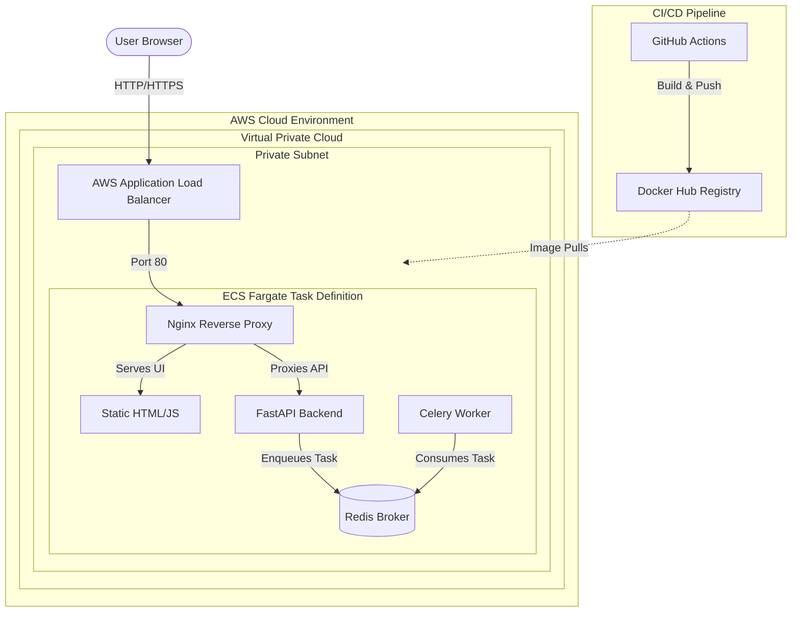

# DevOps Assessment Assignment: Task Notifier

## Project Overview

The Task Notifier is a fully decoupled, microservices-based asynchronous notification system. This repository contains the refactored application code, the containerization strategy, the Infrastructure as Code (IaC) provisioning scripts, and the CI/CD pipeline required to deploy the system to a production cloud environment.

### Core Components

**Backend (`backend/main.py`)**: A FastAPI application exposing endpoints to trigger background tasks and poll for their completion status.

**Worker (`backend/worker.py`)**: A Celery worker configured to process asynchronous tasks outside of the main API thread.

**Message Broker**: Redis, serving as both the message broker for Celery and the backend for storing task results.

**Frontend & Reverse Proxy (`frontend/`)**: A single-page HTML/JS application served by an Nginx reverse proxy. Nginx also handles dynamic routing of API requests to the backend.

## Architecture & Cloud Infrastructure

The application has been architected to run as a unified task within AWS Fargate, abstracting away underlying server management. To ensure enterprise-grade security and high availability, the infrastructure utilizes a multi-tier Virtual Private Cloud (VPC) topology with an Application Load Balancer (ALB) routing traffic to the containers hosted in isolated private subnets.



## Deliverables & Implementation Details

### 1. Application Containerization

The legacy monolithic setup was converted into a robust multi-container environment.

**Dockerfiles**: Created highly optimized Docker images for the Python backend/worker and the Nginx frontend.

**Configuration Management**: All hardcoded network addresses and credentials were abstracted into environment variables (e.g., `REDIS_URL`, `BACKEND_HOST`) to ensure portability across environments.

**Orchestration**: A comprehensive `docker-compose.yml` was developed to manage the entire stack, including network bridging and startup dependency sequencing.

### 2. Local Development & Monitoring

The repository includes a turnkey solution for developers to run and test the infrastructure locally without installing underlying dependencies.

**Log Observability**: Developers can monitor real-time, aggregated logs across all microservices using `docker compose logs -f`. To debug specific bottlenecks, logs can be isolated by container (e.g., `docker compose logs -f worker` to trace background task execution).

Please refer to the [**instructions.md**](instructions.md) file for comprehensive, step-by-step commands to build the images, start the stack, and monitor these logs.

### 3. Cloud Deployment & Observability (IaC)

The cloud deployment strategy eliminates manual provisioning through the use of Terraform and leverages managed services to maximize reliability.

**Terraform Templates**: The `terraform/` directory contains standard configuration files (`main.tf`, `variables.tf`, `ecs-task-def.tf`, `network.tf`, `alb.tf`, `security.tf`) designed to provision an Amazon Elastic Container Service (ECS) cluster within a secure VPC topology.

**AWS Fargate**: The system leverages AWS Fargate as the primary managed service. This serverless compute engine was selected to remove the operational overhead of managing EC2 instances while providing native integration with AWS VPC networking.

**Cloud-Native Logging & Monitoring**: To satisfy the requirement for cloud-native monitoring, the ECS Task Definition is designed to utilize the `awslogs` driver, which automatically ingests and indexes container output in **Amazon CloudWatch**. Furthermore, **ECS Container Insights** is enabled via Terraform to provide out-of-the-box telemetry for CPU, memory, and network metrics.

### 4. Continuous Integration and Continuous Deployment (CI/CD)

Automated pipelines were established to guarantee code quality and deployment readiness.

**GitHub Actions**: A workflow (`.github/workflows/ci-cd.yaml`) is configured to trigger on pushes and pull requests to the main branch.

**Artifact Management**: The pipeline automatically securely logs into Docker Hub, builds the latest multi-architecture container images, and pushes them to the public registry for immediate consumption by the cloud environment.

### 5. Frontend Refactoring

The original frontend was updated to interact dynamically with the new containerized architecture.

The `index.html` file now utilizes asynchronous JavaScript to trigger the `POST /notify/` endpoint and poll the `GET /task_status/{task_id}` endpoint.

All API calls are executed via relative paths, completely managed by the Nginx reverse proxy to prevent Cross-Origin Resource Sharing (CORS) issues and simplify cloud routing.

## Repository Structure

```text
├── .github/workflows/       # CI/CD pipelines (GitHub Actions)
├── backend/                 # FastAPI application and Celery worker
│   ├── main.py              # API routes and application entry point
│   ├── worker.py            # Celery task definitions
│   ├── requirements.txt     # Python dependency mapping
│   └── Dockerfile           # Backend and worker container definition
├── frontend/                # Nginx configuration and static assets
│   ├── index.html           # Single-page frontend interface
│   ├── nginx.conf.template  # Envsubst-compatible proxy configuration
│   └── Dockerfile           # Web server container definition
├── terraform/               # Infrastructure as Code
│   ├── alb.tf               # Application Load Balancer and Target Groups
│   ├── ecs-task-def.tf      # AWS Fargate task and container definitions
│   ├── main.tf              # AWS Provider, ECS Cluster, and Container Insights
│   ├── network.tf           # VPC, Subnets, and NAT Gateway configurations
│   ├── security.tf          # Zero-trust Security Group rules
│   └── variables.tf         # Parameterized deployment variables
├── docker-compose.yml       # Local development orchestration
├── instructions.md          # Local setup and debugging guide
├── journey.md               # Architectural decisions and engineering process
└── README.md                # Project documentation landing page
```

## Further Reading

To properly evaluate this assessment, please review the supplementary documentation outlining the engineering methodology and operation instructions:

1. [**Local Setup Instructions (instructions.md)**](instructions.md): A guide for running the containerized setup locally and monitoring the service logs.

2. [**Engineering Journey (journey.md)**](journey.md): A detailed breakdown of the architectural design decisions, code refactoring, and networking challenge resolutions encountered during development.